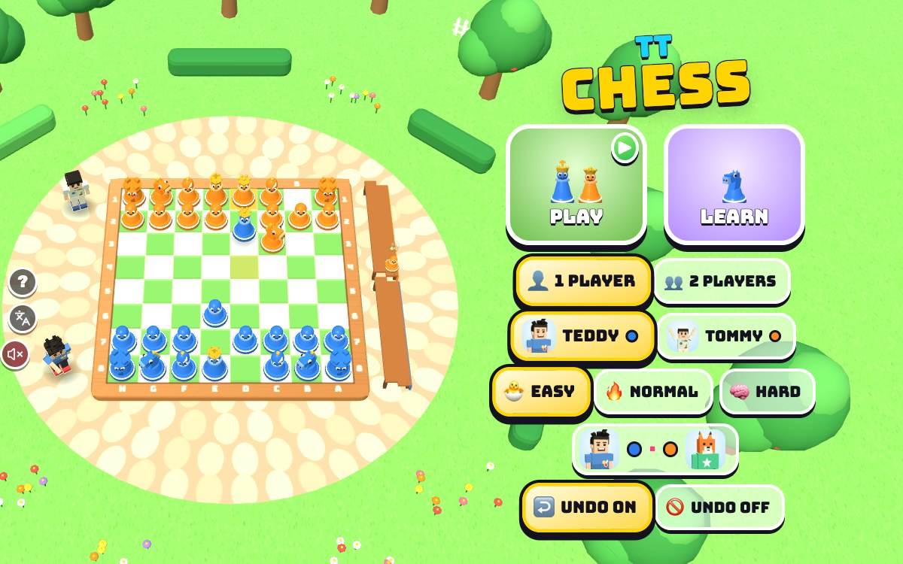

# TT Chess

[](https://adong.github.io/chess-tt/)

Press **?** any time (or tap the round **?** button on the left edge) to see the keys. The game waits while you look.
Tap the language button under it (the A文 icon) to switch between English and 中文; the dashboard and every game remember the choice.

Chess on a bright 3D board in a garden, Teddy's blue toy pieces against Tommy's orange ones. 1 player against Foxy 🦊 the CPU friend (🐣 EASY, 🔥 NORMAL or 🧠 HARD), 2 players on one device, and LEARN: a short lesson for every piece and four mini-challenges.

**中文：** 花园里的 3D 国际象棋：Teddy 的蓝色玩具棋子对 Tommy 的橙色棋子。单人和电脑朋友 Foxy 🦊 下（简单、普通、困难），两人一起玩，还有“学一学”：每个棋子一节小课，加上四个小挑战。

Chess with every rule, starring Teddy and Tommy, built with Claude Code from plain JavaScript and Three.js on the shared Claude Games kit. The board is a chunky wooden tray on a round stone patio, with round apple trees, hedges, flowers, a picket fence and a little pond around it, and a bench beside the board for each side's bonked pieces. There are no image, model or audio files: the boys and Foxy are the kit's blocky characters, the pieces are built from simple shapes, every texture is painted on a canvas, and every sound is synthesised.

The name is a working title. It lives in one constant, `CH_TITLE` in `js/title.js`, and the page title, the logo and the ? panel read it from there.

## Play

- **Double-click `index.html`.** It works offline because Three.js and the kit are copied into `kit/`. Without internet the title font falls back to Arial Black.
- **Send one file:** `dist/chess-tt.html` is the whole game in one page. AirDrop or email it, then open it in a browser.
- Rebuild that file after any edit: `python3 kit/tools/bundle.py . --name chess-tt`

### A game

- **Teddy's pieces are blue and Tommy's are orange.** In 1 player you pick which brother you are, and Foxy 🦊 plays the other colour. Pick Foxy's level: **🐣 EASY** (the default), **🔥 NORMAL** (for Teddy) or **🧠 HARD** (for Dad). Each brother's level is remembered. In 2 players Teddy and Tommy take turns on one device.
- **White moves first, and the boys take turns at being White.** You're White in the first game; after that it swaps every game. Your pieces are always at the end nearest you. **🔃** (or **F**) turns the board round.
- **The pieces are chunky toys with big eyes,** easy to tell apart: the pawn has a round head, the knight is a horse's head with a yellow mane, the bishop wears a tall egg-shaped hat with a slit, the rook is a castle tower with a door, the queen has a gold crown with beads, and the king is the tallest, with a crown and a cross.
- **Tap one of your pieces** to pick it up. It floats and wiggles, its name shows over it (KNIGHT, 马…), and the squares it can go to light up: green dots for a move, a red ring and a 💥 over a piece it can bonk, a 👑 where a pawn would get to the end, and a 🏰 for castling. Tap a lit square to move, or another of your pieces to swap.
- **Tap a square it can't go to** and, if the rules are the reason, it says so: SAVE YOUR KING FIRST! or THAT WOULD PUT YOUR KING IN DANGER! Tapping Foxy's piece says THAT'S NOT YOURS!
- **The last move** stays marked in soft yellow. **Check** is hard to miss: the king's square glows red with a pulsing red ring and a ⚠️, a CHECK! burst pops over it, and a red CHECK! pill shows under the score. The ♟️ over a boy's head shows whose turn it is.
- **A capture** is a silly **BONK!** (a big one shakes the camera), and the bonked piece spins through the air to its side's bench beside the board, where it sits with dizzy stars 💫. Nobody gets hurt.
- **A pawn at the far end** asks **WHAT WILL IT BE?** with four big buttons (queen, rook, bishop, knight, or keys 1–4 / Q R B N), then turns into it with a TA-DA! Foxy picks for himself.
- **↩️ Undo** takes back your last move (and Foxy's answer, in 1 player; one move in 2 players). It works after a game is over too, and the result comes off the score; a bonked piece hops back off the bench and a promoted pawn turns back into a pawn. Switch it off on the home screen (UNDO OFF) for a real game.
- **A win:** the winner does his signature move (Teddy's boxing combo or 🏀 jump shot, Tommy's Y with peace fingers ✌️; Foxy waves), the loser shrugs, confetti falls when a kid wins, then **PLAY AGAIN**. The score at the top keeps running until you change who plays or the level.

## Learn

**LEARN** (on the home screen, or 🎓 on the pause screen) is for Tommy. Every lesson starts with a picture card: the piece, a little board with green dots where it can go, and a few words. Then you play it on the real board. Done lessons get a ✅ (remembered).

| Lesson | What you do |
|---|---|
| PAWN | "Pawns walk forward. The first step can be two!" Step to the ⭐, then bonk Foxy's pawn on the slant. |
| ROOK | "The rook goes straight. Zoom!" Three ⭐ to collect. |
| BISHOP | "The bishop goes on the slant." It stays on its own colour. |
| KNIGHT | "The knight hops in an L. It can jump!" It hops over a row of pawns. |
| QUEEN | "The queen goes any way. Super strong!" Straight and on the slant. |
| KING | "The king takes one step at a time." Keep him safe! |
| ⭐ ROOK TO THE STAR | A little maze: 3 moves is ⭐⭐⭐, 4 is ⭐⭐. |
| 🏁 PAWN RACE | Your pawn against Foxy's: get to the end first. Only the big first step wins it; lose and it says FOXY WON THE RACE! TRY THE BIG FIRST STEP! |
| 🐴 CATCH THE KNIGHT | Your queen chases Foxy's knight, which hops away (it never bonks back). |
| 👑 CHECKMATE! | Two checkmates in one move: a rook on the back row, then a queen. A wrong move says NOT CHECKMATE YET!, and a stalemate says OOPS, STALEMATE! THAT IS A DRAW. |

A pawn that walks past its star can't come back: OOPS! LET'S TRY AGAIN! and the lesson starts over. 🔄 (or R) starts it again any time, 📚 (or Esc) goes back to all the lessons. Your brother helps here too: he points the way to the next star.

## Rules

All of chess:

- **The moves:** the king one square any way; the queen any distance in a line; the rook straight; the bishop on the slant; the knight in an L, jumping over pieces; the pawn one square forward (two from its first square), taking one square forward on the slant.
- **Castling (王车易位),** short and long: the king moves two squares toward a rook and the rook jumps over to its other side. Only if neither the king nor that rook has moved, the squares between them are empty, and the king is not in check, doesn't pass through an attacked square and doesn't land on one.
- **En passant (吃过路兵):** a pawn that steps two squares past an enemy pawn standing beside it can be taken as if it had stepped one, but only straight away.
- **Promotion (升变):** a pawn that reaches the far end becomes a queen, rook, bishop or knight.
- **Check (将军)** must be answered. **Checkmate (将死)** wins. **Stalemate (逼和):** no legal move and not in check is a draw.
- **Draws:** the same position three times (same pieces, same side to move, same castling and en passant chances); 50 moves each with no capture and no pawn move; not enough pieces left for anyone to checkmate (king against king, a king and one bishop or knight against a king, or only bishops that all stand on the same colour). A checkmate on the 50th move still wins.

The board's a–h and 1–8 round the rim are chess coordinates; they stay the same in 中文, as in Chinese chess books.

## Controls

| | Keys | Touch |
|---|---|---|
| move round the board · pick up or put down | ← ↑ → ↓ · Enter or Space | tap a piece, then a glowing square |
| put the piece back | Esc | tap it again |
| a pawn at the end: queen · rook · bishop · knight | 1 2 3 4 or Q R B N | the four big buttons |
| undo your last move | U or Backspace | ↩️ |
| call your brother (2 players: high five) | T | his face, bottom right (🙌 in 2 players) |
| turn the board round | F | 🔃 |
| new game | R | 🔄 on the pause screen |
| pause · sound | P or Esc · M | ⏸️ · 🔊 |
| menu: play · learn | Enter · L | the buttons |
| menu: Teddy or Tommy · 1 or 2 players | ← → · ↑ ↓ | the buttons |
| menu: level (easy, normal, hard) · undo on or off | 1 2 3 · U | the buttons |

- **The arrow keys** move the white cursor the way they point on the screen, even with the board turned round.
- **In LEARN:** 1–9 and 0 open a lesson, Enter starts it, R starts it again, Esc goes back.
- **Phones:** held upright, the kit's ? and language buttons move to the bottom left during a game, so the board can use the whole width. On its side, pause, undo and turn go down the left and the sound, the score and whose turn go down the right, so the board gets the whole height.

## Call your brother (companion mode)

**1 player (and LEARN):** Foxy is the CPU, so your brother is free to help. Call him with **T** or by tapping his face (bottom right), **any time and as often as you like** (`Kit.roster.buddyFor`: Tommy for Teddy, Teddy for Tommy).

- **He pops in** beside you in a puff of stars, at his roster `buddyScale`, with his name tag.
- **He says hi** with his signature move (Tommy's Y with ✌️, Teddy's boxing combo) and **tosses you a treat** (🍦 💧 🧃 🍪 🍉 🍌) that arcs into your hand: "🍪 COOKIE FROM TOMMY!"
- **Then he hints.** The best move from the 🔥 NORMAL search: the piece glows blue, its square glows gold with a bouncing 👇, and a toast says what to do:
  - "TOMMY SAYS: CHECKMATE! MOVE THE QUEEN!" when you can win right now;
  - "SAVE YOUR KING! MOVE THE KING!" when you're in check;
  - "YOUR QUEEN IS IN DANGER!" (with a ❗ over it) when the piece he moves could be bonked where it stands;
  - "BONK THE ROOK!" for a good capture;
  - "MOVE THE KNIGHT!" otherwise.
  The search runs while he says hi, a slice per frame, so the page never stops. If it's Foxy's turn when he arrives, he waits for yours.
- **Once you've moved** he does his goodbye move and pops out. Call him again while he's there and he says hi again, brings another treat and points again.

**2 players:** both brothers are already at the board, so **T** (or 🙌) is a **high five**: they jump to meet beside the board (a big leap over it when they stand at opposite ends), slap hands (💥) and jump back. It doesn't change the game.

## Make it yours

- `js/title.js`: the game's name.
- `js/rules.js`, the `LEVELS` table: how deep NORMAL looks (`depth`), HARD's time per move (`time`, in ms), and `margin` (how close to the best move a move must be to be picked now and then, for variety). `EASY` just below it: how often EASY takes a mate in one, grabs a free piece, and how much noise its choices have.
- `js/game.js`, top: `THINK` (Foxy's least thinking time) and `SLICE` (search milliseconds per frame).
- `js/learn.js`, `LESSONS`: each lesson's board (a FEN), its stars and its words.
- `js/stage.js`: the garden, the board, the pieces (`model`), the colours (`COL`).

## How it works, and how it's tested

- `js/rules.js` has no Three.js and no page in it: the board, every rule, the CPU and the hint. The same file runs the game and the headless checks.
  - A 0x88 board with make / unmake, castling rights, en passant, the 50-move counter, and a two-part Zobrist hash for the threefold rule (en passant only counts when a pawn could really take that way).
  - 🐣 EASY: always takes a free queen; takes a mate in one 6 times in 10; grabs a free piece 3 times in 4; otherwise looks one move ahead with lots of noise and only sometimes checks that the square it goes to is safe.
  - 🔥 NORMAL: alpha-beta 3 moves deep with piece-square tables (Tomasz Michniewski's simplified evaluation), picking at random among moves within 0.18 pawns of the best so games differ.
  - 🧠 HARD: iterative deepening for up to 0.7 s a move (usually 6–7 moves deep), with a hash table, captures first (most valuable victim, least valuable attacker), killer moves and history, quiescence search (captures to the end of the swap), a check extension, and a mop-up term that helps it checkmate a lone king.
  - The search is a loop over an explicit stack, not recursion, so a search job (`job.step(ms)`) can stop in the middle of a deep search when its slice of the frame is used up and carry on next frame. The game gives it 8–12 ms a frame.
- `js/game.js` runs the game and turns each move into the hop (the knight leaps), castling's rook, the BONK and the trip to the bench, the sounds and the boys' reactions. `js/learn.js` runs the lessons on a board of their own.
- Console hooks (`window.game`):

```js
game.start({ players: 1, who: 'tommy', level: 'hard', undo: true })   // straight into a game
game.move('e2e4')          // two taps (and the picker for a promotion: 'e7e8n')
game.tap('e2')             // tap a square for whoever's turn it is
game.setup('7k/P7/8/8/8/8/8/K7 w - - 0 1')   // a position from a FEN, same players
game.call()                // call your brother (2 players: high five)
game.undo()                // undo
game.step(2)               // advance 2 s and draw (when the browser tab's animation is throttled)
game.hold(true)            // freeze the live loop, so only game.step() moves time
game.auto(true, 'normal')  // a test bot plays the kid's side too
game.lesson(3); game.lessonGo()   // open the knight lesson and start it
game.check()               // the headless checks below (quick: 2 games a pairing, no HARD)
game.info()                // state, FEN, turn, scores, the brother, the hint, square sizes on screen
```

The same checks run from a terminal with Node:

```bash
node tools/check.js 10
```

```bash
node tools/check.js 2 --quick --sabotage noep
```

```bash
node tools/check.js match hard normal 6 --hard 700
```

- **perft** (the number of positions after 1, 2, 3, 4 moves, the standard test for move generators): from the start 20, 400, 8902 and 197281; from "Kiwipete" 48, 2039 and 97862; and three more standard positions full of en passant, pins, promotions and castling (17 counts, all right).
- **Every rule on a little board set up for it** (66 checks): the start; castling both ways, and not out of check, through check (f1 and d1), into check (g1 and c1), with a piece in the way, after the king moved (even back home), after that rook moved (the other side still fine), after the rook was taken, or without the right; b1 under attack doesn't stop long castling; en passant now, never later, not when it leaves your king open, and no square to take on when nobody can; promotion to each of the four, by taking, and undone; the fool's mate, a back-row mate and a smothered mate; check that must be answered, a king that can't step along the attacking line, a pinned piece; stalemate; threefold (not at two), with an en passant nobody can take, and with castling rights lost; the 50-move rule, the count starting again on a pawn move, and mate on the 50th move still winning; every "not enough pieces" case and the ones that can still mate; an illegal move refused; undo all the way back.
- **The CPU and the hint:** EASY takes a free queen every time (75 tries on 3 boards); NORMAL and HARD find a mate in one; NORMAL moves its queen away from a pawn; HARD plays the scholar's mate when it's there; the hint finds the mate, the queen in danger, getting out of check and a free rook.
- **CPU games:** NORMAL against EASY, EASY against EASY, random against random, and HARD against NORMAL, colours swapping every game. Every move must be legal, every game must end, and the ending must agree with the board (a mate really is a mate). NORMAL must beat EASY, and HARD must beat NORMAL, in more than half the games and at least twice as often as they lose.
- **It can fail:** each `--sabotage` switches one rule off and the check fails: `nodouble`, `noep`, `castlecheck` (castle out of or through check), `castlemoved` (castling rights never lost), `selfcheck` (moves may leave your king in check), `nomaterial`, `nofifty`, `norepeat`, `easyblind` (EASY never sees a queen it could take) and `blind` (NORMAL plays at random and stops beating EASY).
- **At the last check** (`node tools/check.js 10`, 38 seconds, HARD at 150 ms a move): perft 17 of 17, rules 66 of 66; NORMAL beat EASY 10–0, HARD beat NORMAL 10–0, every game ended by checkmate or a draw rule, every move legal. **Full-strength HARD** (700 ms a move): beat NORMAL 6–0 (`match hard normal 6 --hard 700`).
- **The browser:** whole games through the real renderer (`game.auto`) to PLAY AGAIN with no console errors, as Teddy and as Tommy, and the colours swapping each game; Foxy on HARD thinks 0.3–0.7 s and reaches 6–7 moves deep, and with a real frame loop the slowest frame during his search was 20 ms; the promotion picker (and a knight that leaves a dead draw), undo of a promotion and of a capture (the piece comes back off the bench), castling, check; the brother's visit and every kind of hint; the high five; the keyboard (arrows, also with the board turned round, Enter, Esc, U, F, P); every lesson finished by following the brother's hints, and the ways to fail them (the race lost, a pawn stuck past its star, a wrong move and a stalemate in CHECKMATE!). 中文: every screen visited (home, LEARN, every lesson's card and board, the lesson toasts, play, every hint, castling, check, the picker, every ending, pause, 2 players, the high five, the ? panel) and `Kit.lang.untranslated()` stayed `[]`; a planted page string and a planted canvas word were both caught. English: no Chinese anywhere except the kit's language button tooltip. `index.html` and `dist/chess-tt.html` boot and play from `file://` in headless Chrome.
- **Sizes on screen** (a square near the middle, near half / far half): phone upright 390×844 40/38 px; phone on its side 740×360 38/34 px in a game (32/29 in a lesson, under the lesson's words); iPad 768×1024 63/59 px; 1024×768 60/53 px. The kit's left-edge buttons never cover the board.

## Files

```
index.html               page, HUD, menus, the promotion picker, LEARN's screens (CSS inline)
js/title.js              the game's name (one constant)
js/rules.js              the rules, the CPU levels (the pausable search) and your brother's hint (no Three.js)
js/check.js              the headless checks: perft, the rules, the CPU games, sabotage (game.check, tools/check.js)
js/foxy.js               Foxy 🦊: a roster entry on the kit's bear head, with pointy ears and a bushy tail
js/stage.js              the garden, the board, the toy pieces, the benches, moves, bonks, highlights, the camera fit, picking
js/actor.js              a boy (or Foxy) beside the board: poses, reactions, treats (from TT Jungle Chess)
js/buddy.js              your brother's visit and hint, and the 2-player high five
js/learn.js              LEARN: the lessons, the challenges, the picture cards
js/fx.js                 emoji flyers, word bursts, confetti
js/sfx.js                game sounds on top of Kit.sound
js/game.js               the game, turns, undo, Foxy's timing, the score, screens, input, main loop, window.game hooks
js/keys.js               the keys the ? panel shows (Kit.help), and where the kit's buttons go on a tall screen
js/zh.js                 中文 for every word the player sees (Kit.lang); names and the game's name stay English
tools/check.js           runs the headless checks under Node
kit/                     copy of ~/claude-games/kit (python3 ../kit/tools/sync.py .), never edited here
dist/chess-tt.html       the single-page build
```

## Not verified

- **Sound:** the synth code runs without errors, but nobody listened to it.
- **Real touch devices:** tapping was checked in the browser's phone and tablet sizes, but no real phone or iPad was used. A tap on a piece picks its square; a tap on the board picks the square under it.
- **Real kids:** whether 🐣 EASY is gentle enough for Tommy, 🔥 NORMAL right for Teddy and 🧠 HARD a challenge for Dad needs Tommy, Teddy and Dad. The levels were only measured against each other. `LEVELS` and `EASY` in `js/rules.js` are the knobs.
- **Speed on an older iPad:** HARD stops after 0.7 s whatever the device (it just looks less deep on a slower one), and the search gives the page 8–12 ms slices; the frame times were measured on a Mac only.
- **Double-click from Finder:** both pages were opened from `file://` in headless Chrome, not by double-clicking in Finder.
- **The iPad home-screen icon:** the apple-touch-icon is drawn by script like the siblings'; nobody added it to a real iPad.
